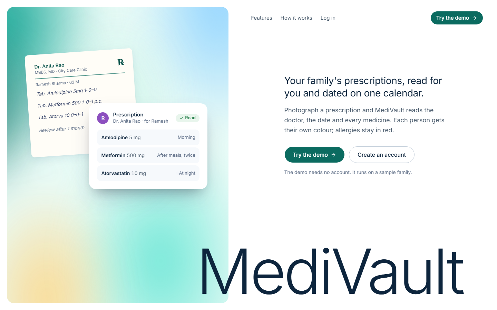
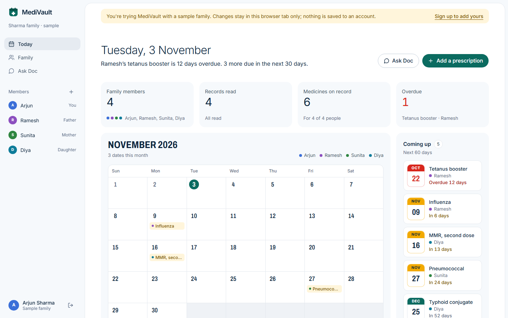
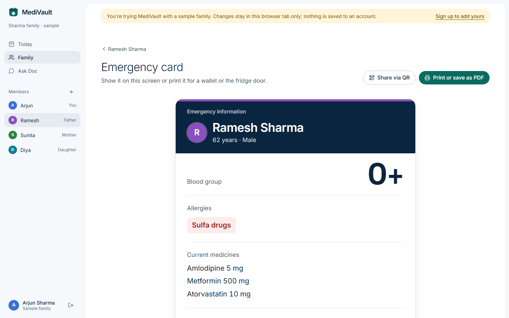
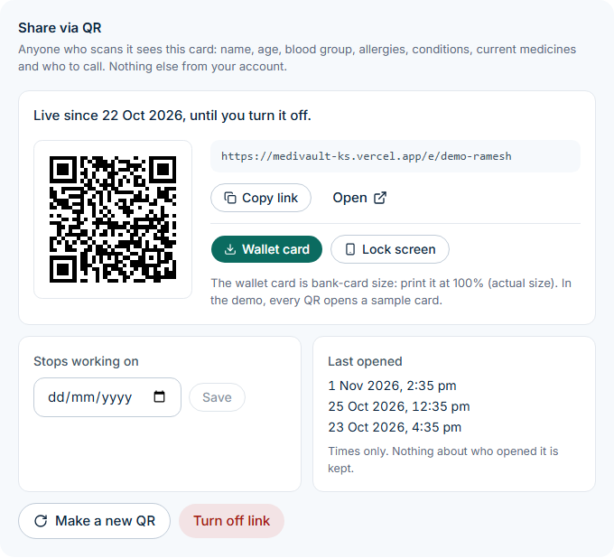
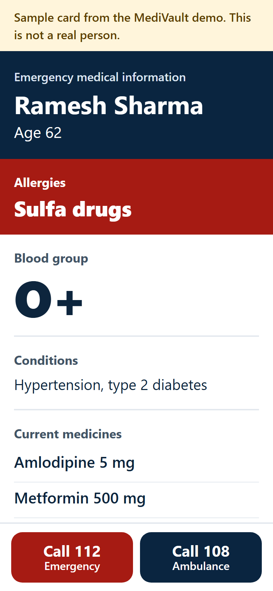
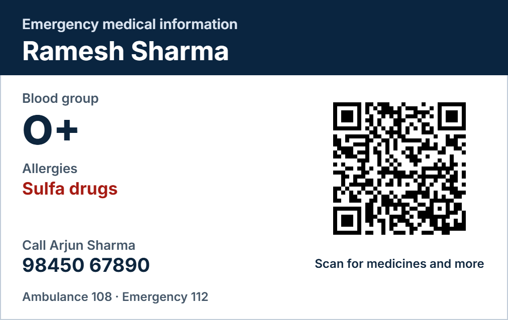

# MediVault

A health records app for families. Upload a prescription or lab report, and MediVault reads it with Gemini and pulls out the doctor, date and medicines, so the whole family's medical history is searchable in one place.

**Live:** [medivault-ks.vercel.app](https://medivault-ks.vercel.app) · [Try the demo](https://medivault-ks.vercel.app/demo) (no account needed) · [Sample QR emergency card](https://medivault-ks.vercel.app/e/demo-ramesh)

**Case study:** [phanindra-ks.vercel.app/projects/medivault](https://phanindra-ks.vercel.app/projects/medivault)

## Features

- **Try it without an account.** `/demo` turns the tab into a full walkthrough with a sample family: every screen works (family, records with their original files, Doc, vaccinations, emergency cards with a sample QR link (its public page is `/e/demo-ramesh`), interaction check, visit summary and the quick answers). The real screens run against an in-browser copy of the sample data (`lib/demo/`), AI tools give labelled sample answers, and nothing is sent to Supabase or the AI. Changes last until the visitor leaves the demo or closes the tab. The landing page shows the real app on a fixed stage that changes as you scroll, and lets you switch between the sample family's emergency cards.
- **Calendar dashboard.** A month view of due and overdue vaccinations and the dates prescriptions were written, each family member in their own colour. Red is kept for overdue items and allergies.
- **Family profiles.** One account manages records for every family member: blood group, allergies, known conditions.
- **Record extraction.** Upload a photo or PDF (JPEG, PNG, WebP, HEIC or PDF, up to 10 MB) of a prescription or report. Gemini extracts the doctor name, the date the doctor wrote it, medicines with dosage and frequency, and notes. The record page shows the original file next to what was read, lets you correct anything (including the date), and offers a retry if reading fails.
- **Current medicines expire.** Each medicine gets an end date worked out from the course length on the prescription ("5 days", "1 month", "5/7"); "continue" or a tick on Ongoing keeps it current (blood pressure, diabetes). The end date can be changed on the record page. "Current medicines" on the member page and emergency card show only ongoing medicines and courses that haven't ended; finished courses sit behind "Show finished courses". A medicine with no course length stays current with a "Check if still taking" prompt (Still taking / Stopped).
- **Doc, the health copilot.** A chat assistant that answers questions using your family's actual records ("what is Dad taking for blood pressure?"). It gives general guidance only and points to a doctor for anything serious.
- **Interaction checker.** Checks a family member's current medicines against each other for known interactions.
- **Visit summary.** Generates a short summary of a member's records to bring to a doctor's appointment.
- **Emergency card.** A large-type page with blood group, allergies, current medicines and a one-tap call button; it prints cleanly on one page.
- **QR emergency card.** "Share via QR" on the card makes a public link (`https://medivault-ks.vercel.app/e/<token>`) with a 256-bit random token, never the member's id. Downloads: a bank-card-size wallet card (PNG at 300 dpi, print at 100%) and a phone lock-screen picture, both drawn in the browser. The public page needs no login, has no scripts, and shows only name, age, blood group, allergies (red, at the top), conditions, current medicines, the emergency contact with a call button, and Call 112 / Call 108. The owner can turn the link off, make a new one (the old QR stops working), set an expiry date, and see when it was last opened (times only). Turned-off, expired and unknown links all show "This card is no longer active".
- **Vaccination tracker** per family member: next due first, overdue in red, due within 30 days in marigold.
- **Quick tools** on the dashboard: medicine lookup, symptom triage, and a translator for medical jargon in doctor's notes.

## Screenshots

Taken from the live site with the demo's sample family. More in [`docs/screenshots`](docs/screenshots).

| Landing | Dashboard |
| --- | --- |
|  |  |

| Emergency card | Share via QR |
| --- | --- |
|  |  |

| Public QR card (phone) | Printable wallet card |
| --- | --- |
|  |  |

## Tech stack

- Next.js 16 (App Router), React 19, TypeScript
- Supabase (Postgres, Auth, Storage)
- Google Gemini API (`@google/generative-ai`)
- Tailwind CSS 4, shadcn/ui (Base UI) components, Motion for animation, lucide icons, Inter and Archivo (dates)

Photographs on the landing page come from Wikimedia Commons and are credited in its footer (`public/photos/credits.json`).

## Security notes

Uploaded files are stored under the user's id in Supabase Storage. The bucket should be private, and every table needs row level security limiting rows to `auth.uid() = user_id`, since the browser client queries them directly. The two API routes that use the service-role key (`doc-chat` and `extract-record`) identify the user from their Supabase access token, sent as a bearer token, and only touch rows owned by that user. `extract-record` also refuses any stored file path outside the caller's own folder, because the service-role client ignores storage policies.

Every AI route requires a login, checks the shape and size of its input, and counts against a daily allowance of 30 AI requests per account (stored in the user's `app_metadata`, resets at midnight India time). Text fields have the same length limits in the forms (`lib/limits.ts`) and in the database (check constraints in `schema.sql`). `next.config.ts` sends a Content-Security-Policy, `X-Frame-Options: DENY`, `Referrer-Policy`, `X-Content-Type-Options` and, on non-local hosts, HSTS. Logging out ends the session on the current device only.

Emergency card links: the database stores only a SHA-256 hash of each token (`emergency_links`, RLS per user, one live link per member). `/e/[token]` is a route handler that hashes the token, looks it up with the service-role key and returns only that member's emergency fields; it is rate limited (30 requests a minute per IP, in memory per server instance), sends `noindex` and `no-store`, and writes only a timestamp to `emergency_link_opens` (the latest 20 are kept). The device that made a link keeps the token in `localStorage` so the QR can be downloaded again there; other devices have to make a new one.

## Running locally

Requires Node 20+ and a Supabase project.

```bash
git clone https://github.com/phanindraks2005/medivault.git
cd medivault
npm install
cp .env.example .env.local   # fill in your keys
npm run dev
```

The app runs at http://localhost:3000.

### Environment variables

| Variable | Description |
| --- | --- |
| `NEXT_PUBLIC_SUPABASE_URL` | Supabase project URL |
| `NEXT_PUBLIC_SUPABASE_ANON_KEY` | Publishable key (`sb_publishable_...`) or legacy anon key, used by the browser client |
| `SUPABASE_SERVICE_ROLE_KEY` | Secret key (`sb_secret_...`) or legacy service role key, used only in server routes. Never expose it to the client |
| `GEMINI_API_KEY` | Google AI Studio API key |
| `NEXT_PUBLIC_CARD_LINK_BASE` | Optional. Base URL for emergency card QR links; defaults to `https://medivault-ks.vercel.app`. Set it to your dev server's LAN address (e.g. `http://192.168.1.20:3000`) to scan a QR from a phone while testing |

### Database

Run [`supabase/schema.sql`](supabase/schema.sql) once in the Supabase SQL Editor of a new project. It creates the tables (`family_members`, `medical_records`, `vaccinations`, `chat_history`, `emergency_links`, `emergency_link_opens`, each with a `user_id` tied to `auth.users`), turns on row level security with per-user policies, and sets up the private `medical-records` Storage bucket (10 MB, images and PDFs) with policies that keep each user's files in their own folder. It also adds length limits on text columns, requires a date on vaccinations, and requires each record's file path to sit in its owner's folder (added `NOT VALID`, so existing rows are left alone). The script is safe to run again.

For local testing you can turn off email confirmation under Authentication → Sign In / Providers → Email.

### Keep-alive

`.github/workflows/supabase-keep-alive.yml` makes one small read query to Supabase every 3 days so a free project is not paused for inactivity. It needs two repository secrets (Settings → Secrets and variables → Actions): `SUPABASE_URL` (the project URL) and `SUPABASE_ANON_KEY` (the anon/publishable key). It re-enables itself on every run, so GitHub never turns it off for inactivity, and it can also be run by hand from the Actions tab.

### AI models

All Gemini calls go through `lib/gemini.ts`. It uses `gemini-3.5-flash` and falls back to `gemini-3.5-flash-lite` when the first model is busy or out of quota, with a 25 second timeout. On the free tier each model allows about 20 requests a day, so heavy testing can hit the limit; the app then shows a "busy, try again" message instead of failing silently. A record whose extraction failed can be read again from its page with **Try again**.

## Disclaimer

MediVault is a personal project, not a medical device. AI output can be wrong; always confirm medical decisions with a doctor or pharmacist.
